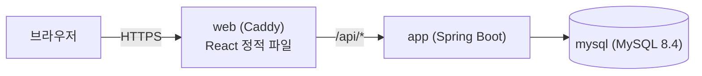
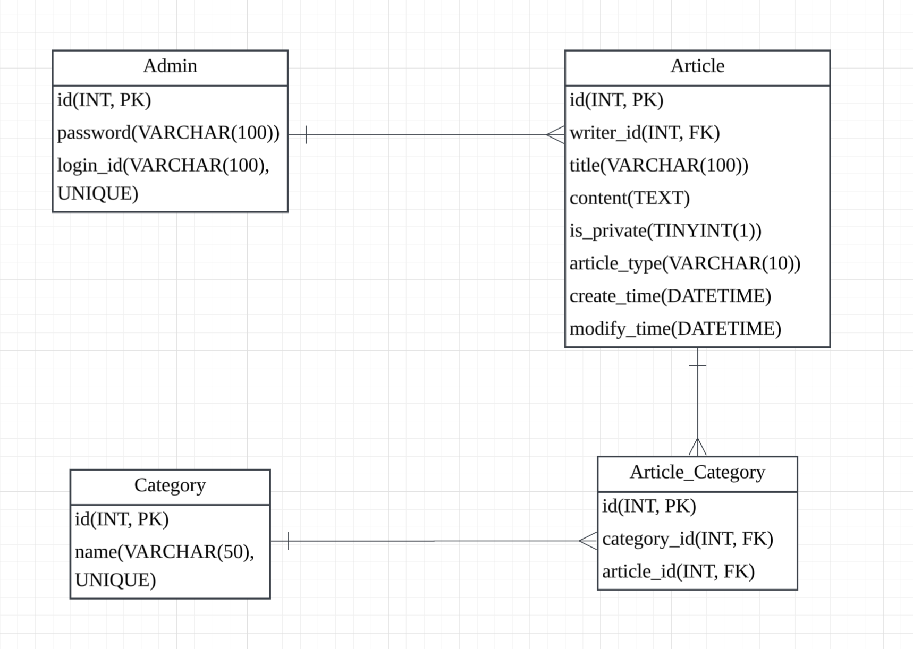

# Portfolio Blog

Spring Boot로 직접 만든 포트폴리오 겸 기술 블로그입니다.
관리자 1명이 글을 쓰고, 방문자는 글을 읽는 구조입니다.

**사이트**: https://aaasazzz-blog.duckdns.org

## 프로젝트 소개

- **기간**: 2026-11-02 ~ 2026-11-12
- **인원**: 1명
- **목표**
  - 설계(요구사항 → ERD → API)부터 배포까지 백엔드 전 과정을 직접 해보기
  - GitHub Flow(브랜치 → PR → CI → merge)로 버전 관리하기

## 주요 기능

| 기능 | 내용 |
|---|---|
| 글 | 마크다운 본문, 공개/비공개, 일반 글과 프로젝트 글 구분 |
| 카테고리 | 글 하나에 여러 카테고리(다대다), 삭제 전 함께 지워질 글 수 미리보기 |
| 목록 | 페이징, 제목·본문 검색, 카테고리(OR)·글 종류 필터 |
| 로그인 | 세션 + 인터셉터로 관리자 API 보호(401), 비밀번호 BCrypt 암호화 |
| 이미지 | 본문 이미지와 썸네일 업로드, 실제 파일 형식 검사, 5MB 제한, 쓰지 않는 파일 매일 정리 |
| 관리자 화면 | `/admin`에서 글 작성(입력과 미리보기 나란히), 카테고리 관리 |

## 기술 스택

| 구분 | 기술 |
|---|---|
| Backend | Java 25, Spring Boot 4.1, Spring Data JPA, Bean Validation |
| Database | MySQL 8.4 |
| Frontend | React, Vite, TypeScript |
| Infra | Docker Compose, Caddy, AWS EC2, GitHub Actions |

## 아키텍처



- 세 서비스를 Docker Compose 하나로 실행합니다.
- Caddy가 HTTPS 인증서를 자동으로 발급하고, `/api/*` 요청은 Spring으로 전달합니다.
  프론트와 API가 같은 도메인이라 CORS 설정이 필요 없습니다.
- MySQL과 Spring은 외부에 포트를 열지 않고 Docker 내부 네트워크로만 통신합니다.
- DB 데이터, 업로드 이미지, HTTPS 인증서는 Docker 볼륨에 저장해 컨테이너를 다시 만들어도 유지됩니다.

## 문서
- [API 명세](docs/API.md): 요청·응답 형식, 에러 코드
- [개발 기록](docs/dev_log.md): 단계별로 만든 것, 배운 것, 문제와 해결



## 실행 방법

### 1. 환경변수

프로젝트 루트에 `.env` 파일을 만듭니다. (`.env`는 Git에 올리지 않습니다)

```properties
MYSQL_ROOT_PASSWORD=
MYSQL_USER=
MYSQL_PASSWORD=
ADMIN_LOGIN_ID=
ADMIN_PASSWORD=
```

관리자 계정은 첫 실행 때 `ADMIN_LOGIN_ID`, `ADMIN_PASSWORD` 값으로 만들어집니다.

### 2. 전체 실행 (Docker)

```bash
docker compose up -d --build
```

http://localhost 에 접속합니다.

### 3. 개발 모드

```bash
docker compose up -d mysql   # DB만 실행
./gradlew bootRun            # 백엔드 (localhost:8080)
cd frontend && npm install && npm run dev   # 프론트 (localhost:5173, /api는 8080으로 프록시)
```

### 4. 배포 서버 추가 설정

| 변수 | 값 | 이유 |
|---|---|---|
| `SITE_ADDRESS` | 도메인 | Caddy가 이 도메인으로 HTTPS 인증서 발급 |
| `WEB_BIND` | `0.0.0.0` | 외부에서 80, 443 포트로 접속 허용 |
| `COOKIE_SECURE` | `true` | 세션 쿠키를 HTTPS에서만 전송 |

## 프로젝트 구조

```
├── src/main/java/com/portfolio/blog
│   ├── admin       # 관리자 엔티티, 첫 실행 시 계정 생성
│   ├── article     # 글 API
│   ├── category    # 카테고리 API
│   ├── auth        # 로그인, 로그인 확인 인터셉터
│   ├── image       # 이미지 업로드, 정리 작업
│   └── global      # 설정, 공통 에러 처리
├── frontend        # React 화면, Caddyfile, 프론트 Dockerfile
├── docs            # API 문서, ERD, 개발 기록
├── Dockerfile      # Spring 이미지
└── compose.yaml    # mysql, app, web 세 서비스
```

## AI 활용

- 백엔드 설계와 대부분의 구현은 직접 했고, 처음 다룬 분야(세션, 이미지 업로드, Docker, CI 설정)는
  AI가 제시한 코드를 이해한 뒤 사용했습니다. 프론트 화면은 AI로 생성했습니다.
  단계별 내용은 [개발 기록의 AI 활용](docs/dev_log.md#15-ai-활용)에 있습니다.